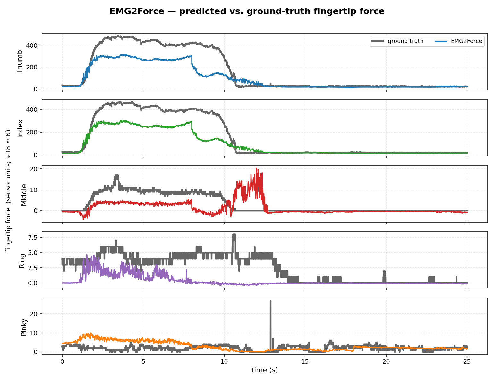

# ForceBand: Learning Forceful Manipulation with sEMG

[](https://arxiv.org/abs/2606.26093)
&nbsp;[](https://forceband-emg.github.io/)
&nbsp;[](https://www.python.org/)
&nbsp;[](LICENSE)

Official **EMG2Force model** code for **"ForceBand: Learning Forceful Manipulation
with sEMG"** ([arXiv:2606.26093](https://arxiv.org/abs/2606.26093) ·
[project page](https://forceband-emg.github.io/)).

ForceBand is a low‑cost wrist‑worn **sEMG + IMU** band; its **EMG2Force** model
predicts per‑finger fingertip forces (thumb, index, middle, ring, pinky) from the
8‑channel sEMG + IMU stream — a DINOv2 ViT‑S spectrogram encoder + Transformer
(~28.5 M params) that conditions on the previous window's force for continuity.

<!-- <p align="center">
  
  <br/><em>EMG2Force on a held‑out validation session — predicted (color) vs. ground‑truth (grey) per‑finger force.</em>
</p> -->

## What ships

| Artifact | Status | Where |
|---|---|---|
| ✅ Pretrained checkpoint (DINOv2, Apache‑2.0) | released | `checkpoints/` |
| ✅ Validation set — held‑out pretraining chunks, ~5‑min quick checkpoint test | released | `data/val/` · `data/splits/val.txt` |
| ✅ Deploy‑demo set — calibration + held‑out validation | released | `data/demos/` · `data/splits/{calib,demo_val}.txt` |
| ⏳ Full pretraining dataset | **under preparation** | — |
| ➕ RGB overlay videos (optional, ~1.3 GB) | Google Drive | `scripts/download_videos.py` |

## Roadmap

**Before paper acceptance**
- [ ] Hardware DIY tutorial (build your own ForceBand)
- [ ] Full pretraining dataset
- [ ] Robot policy training pipeline
- [ ] DINOv3 backbone variant — its [license](https://ai.meta.com/resources/models-and-libraries/dinov3-license/) needs further validation on our side before we redistribute, so for now we ship DINOv2; planned as an opt‑in *download‑DINOv3‑yourself* recipe (the two perform on par — see [Backbones](#backbones--dinov2-shipped-vs-dinov3))

**By the weekend (Sun 2026‑06‑28)**
- [ ] EMG hardware survey
- [ ] More human demonstration data
- [ ] Minor fixes + more readable README

## Install

```bash
conda env create -f environment.yml && conda activate emg2force
pip install -e .                          # or: pip install -r requirements.txt
```

GPU recommended. **No backbone download** is needed for eval or calibration — the
ViT is built untrained and overwritten by the checkpoint's weights (only
`train.py` from scratch fetches backbone weights).

## Tutorial 1 — Evaluate the checkpoint (~5 min)

```bash
python scripts/evaluate.py                 # released DINOv2 (Apache-2.0) checkpoint, validation split
```

Writes `overall_metrics.csv`, `per_session_metrics.csv`, and pred‑vs‑GT / scatter
plots to `results/eval/teacher_forced/`. Eval is **teacher‑forced** (each window
anchored on the ground‑truth previous force); `--mode rollout` exists but is not
the reported metric.

Reference — mean over fingers, 7 val sessions (sensor units; ÷18 ≈ N). Per‑finger
CSVs in `results/reference{,_dinov2}/`.

| MAE | RMSE | R² | Pearson r |
|---:|---:|---:|---:|
| 17.63 | 39.85 | 0.453 | 0.698 |

Thumb/index/middle track strongly (R² 0.68/0.65/0.50); ring & pinky carry little
force and are noisier.

## Tutorial 2 — Calibrate on robot demonstrations

The checkpoint transfers in *shape* but not absolute *scale* to a new setup, so a
short calibration is needed. Demo splits: **`calib.txt`** = demos 0–35
(fine‑tune), **`demo_val.txt`** = demos 36–93 (validate); demos 94–111 are
excluded (no force — see `data/demos/manifest.csv`).

```bash
python scripts/evaluate.py --split demo_val.txt --out results/demo_zeroshot   # 1) baseline
python scripts/finetune.py                                                    # 2) calibrate on demos 0–35
python scripts/evaluate.py --checkpoint <finetuned.ckpt> --split demo_val.txt # 3) validate
```

`finetune.py` writes a self‑describing checkpoint and prints the exact eval
command. Reporting driven‑finger metrics (thumb/index/middle), calibrating on
demos 0–35 cuts error ~5× on the held‑out demos:

| DINOv2 on `demo_val` | MAE | RMSE | Pearson r* | R²* |
|---|---:|---:|---:|---:|
| zero‑shot | 46.0 | 59.3 | 0.59 | −4.94 |
| **calibrated** | **9.5** | **16.3** | **0.78** | **+0.58** |

<sub>*driven‑finger mean (thumb, index, middle).</sub>

## Backbones — DINOv2 (shipped) vs. DINOv3

The release ships the **Apache‑2.0 DINOv2 ViT‑S/14** backbone (`timm` id
`vit_small_patch14_reg4_dinov2.lvd142m`); `evaluate.py` / `finetune.py` /
`load_model()` auto‑detect it from the checkpoint. We also trained a DINOv3
ViT‑S/16 variant — the two are effectively on par, so we ship DINOv2 (a DINOv3
recipe is on the [roadmap](#roadmap)):

| backbone | val MAE | val R² | val Pearson r | demo calib. — MAE (zero‑shot → cal.) |
|---|---:|---:|---:|---:|
| **DINOv2 ViT‑S/14** (shipped) | 17.63 | 0.453 | 0.698 | 46.0 → 9.5 |
| DINOv3 ViT‑S/16 | 18.00 | 0.424 | 0.696 | 36.7 → 9.3 |

<sub>Val = 7 held‑out sessions (teacher‑forced); demo calibration fits demos 0–35 and validates on 36–93.</sub>


## Data format

HDF5 at 1 kHz under group `forceband/timeseries` (reader in `emg2force/data.py`):

| dataset | shape | meaning |
|---|---|---|
| `timestamps` | `(N,)` | seconds from session start |
| `emg` | `(N, 8)` | 8‑channel sEMG (cols 1:9 if stored 24‑wide) |
| `imu` | `(N, 10)` | quaternion[4] + gyro[3] + acc[3] |
| `force` | `(N, 5)` | fingertip force, sensor units (÷18 ≈ N) |

Programmatic use: `from emg2force import load_model; m = load_model(config="dinov2")`.
Optional RGB overlays: `python scripts/download_videos.py` then `evaluate.py --video`.

## Citation

```bibtex
@article{he2026forceband,
  title   = {ForceBand: Learning Forceful Manipulation with sEMG},
  author  = {He, Botao and Wang, Zhi and Kuang, Linna and Ghosh, Ishaan and Malik, Jitendra and Fermuller, Cornelia and Wu, Tingfan and Mao, Jiayuan and Liu, Ruoshi and Qi, Haozhi and Aloimonos, Yiannis},
  journal = {arXiv preprint arXiv:2606.26093},
  year    = {2026}
}
```

## Acknowledgements

We build on Meta's **DINOv2** (shipped) and **DINOv3** backbones (via `timm`),
and thank the authors of **emg2pose**.
